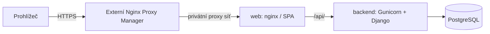

# Technická architektura

Architektura, aktualizace 3. 11. 2026. Ve fázi 1 vznikl základ frontend/backend/infra a Compose. Runtime Dockeru zůstává v tomto prostředí neověřený; aktuální výsledky jsou v PHASE_1.md. Ve fázi 2 vznikl modul vehicles s modely, selektory, servisní vrstvou, API a UI; ve fázi 3 vznikl refuelings (tankování, přílohy v DB, historie a XLSX). Fáze 4 přidává analytics, intervalové podklady a dashboard. Fáze 5 doplňuje UX, přístupnost a veřejný PWA shell. Aktuální ověření včetně místního HTTPS nginx/Gunicorn je v PHASE_5.md. Podle doplňujícího pokynu uživatele všechna trvalá aplikační data včetně originálů/náhledů účtenek patří do PostgreSQL.

## 1. Modulární monolit

Jedno úložiště zdrojů, jedna Django aplikace rozdělená do domén, PostgreSQL a webová vstupní služba. React je SPA. Bez Redis, Celery, message brokeru, mikroservis nebo objektového úložiště, dokud nebude doložená potřeba. Nákupní i měřicí statistiky počítá backend, frontend pouze vykresluje a lokálně navrhuje částku formuláře.

Rozložení repozitáře (vehicles/refuelings/analytics jsou implementované):

```text
frontend/                 React, komponenty, feature moduly a testy
backend/
  config/settings/        base.py, development.py, production.py, test.py
  apps/accounts/          vlastní User od první migrace, autentizace a správa
  apps/vehicles/          auta, granty a autorizační selektory
  apps/refuelings/        záznamy, validace, soukromé účtenky, XLSX
  apps/analytics/         čisté výpočty intervalů a dashboardové služby
  apps/audit/             audit významných změn
infra/                    Dockerfiles, nginx a později provozní postupy
docs/                     specifikace a rozhodnutí
compose.yaml              společné interní služby a svazky
compose.dev.yaml          hot reload a 127.0.0.1:8080
compose.prod.yaml         produkční build, Gunicorn, externí síť NPM
.env.example              názvy proměnných bez tajných hodnot, od fáze 1
.dockerignore             vyloučení tajných/provozních dat z buildu, od fáze 1
```

Django: views/serializers ověřují kontrakt, selektory omezují čtení podle práv, servisní funkce provádějí zápisy v transakcích a audit. Čisté jádro `analytics/consumption.py` nepřistupuje k HTTP, ORM ani uživatelským sessions; dostává immutable typované a seřazené vstupy. `analytics/services.py` obsluhuje autorizované načtení a skládání API výsledků. Statistické endpointy nejprve vyberou autorizovaná vozidla. Sdílené autorizační funkce používá i Django admin nebo je zápis mimo servisní vrstvu zakázaný.

React: feature moduly `auth`, `vehicles`, `refuelings`, `dashboard`, `administration`; společný API klient, komponenty, formátování a tokeny vzhledu. TanStack Query pro serverová data a invalidaci po změnách; React Hook Form + Zod pro formuláře. Žádný druhý globální store bez potřeby. Při odhlášení nebo ztrátě session vyčistit query cache a soukromé náhledy.

## 2. Technologie a ověřené řady

Ve fázi 1 jsou přesné závislosti zamknuté v `frontend/package-lock.json` a `backend/uv.lock`. Metadata verzí byla znovu ověřena přímo v registrech npm/PyPI a digesty image v oficiálním registry Dockeru. Konkrétní použité verze a testovací prostředí uvádí PHASE_1.md. Nové major verze se nepřebírají automaticky.

| Oblast | Návrh | Důvod a oficiální zdroj |
| --- | --- | --- |
| Python | 3.14, nejnovější patch | Podporovaná řada kompatibilní s Django 5.2; [stav Python verzí](https://devguide.python.org/versions/), [kompatibilita Django](https://docs.djangoproject.com/en/5.2/releases/5.2/) |
| Django | 5.2 LTS, nejnovější patch | Podpora do dubna 2028; novější 6.1 má kratší horizont podpory. [Oficiální přehled](https://www.djangoproject.com/download/) |
| DRF | 3.18, nejnovější patch | V době průzkumu release notes uvádějí 3.18.3; [požadavky](https://www.django-rest-framework.org/), [vydání](https://www.django-rest-framework.org/community/release-notes/) |
| PostgreSQL | 18, nejnovější minor | Podporovaná řada do listopadu 2030; [versioning policy](https://www.postgresql.org/support/versioning/) |
| Node.js | 26 LTS | Aktuální LTS k datu návrhu, jen build a vývoj; [release schedule](https://github.com/nodejs/Release) |
| React | 19.3 | Aktuální dokumentovaná řada; [React versions](https://react.dev/versions) |
| Vite | 8.3 | Aktuálně podporovaná řada pro pravidelné opravy; [Vite releases](https://vite.dev/releases) |
| Tailwind | 4.3 | Vite integrace v aktuální dokumentaci; [oficiální návod](https://tailwindcss.com/docs/installation/using-vite) |
| Další frontend | TypeScript, shadcn/ui, Lucide, Recharts, TanStack Query, RHF, Zod | Přesné stabilní kompatibilní verze prověřit při zavedení konkrétní funkce |
| Další backend | psycopg, Gunicorn, openpyxl, Pillow, django-axes | Přesné verze a podporu Python/Django uzamknout při zavedení |

Frontend používá npm a verzovaný `package-lock.json`, instalace přes `npm ci`. Backend `pyproject.toml` + `uv.lock`, synchronizace `uv sync --frozen` (v produkci bez vývojových závislostí). Verze uv i base images jsou připnuté; produkční obrazy na konkrétní tag a digest. Vygenerované shadcn komponenty se verzují a kontrolují jako vlastní zdrojový kód. Aktualizace locků jsou samostatná ověřená změna. Upgrade Django před koncem podpory je součást údržby.

## 3. Lokální Docker Compose

| Služba | Vývoj | Produkce |
| --- | --- | --- |
| `web` | nginx → Vite a Django | nginx se sestaveným SPA → Gunicorn |
| `frontend` | Vite, interní 5173, bind mount a HMR | Pouze build stage, žádný trvalý Node server |
| `backend` | Django runserver, interní 8000, bind mount | Gunicorn WSGI, interní 8000, immutable image |
| `db` | PostgreSQL, interní 5432 | PostgreSQL, interní 5432 |

Hostitel publikuje ve vývoji pouze `127.0.0.1:8080` na `web`. `/api/` jde na Django, ostatní cesty na Vite včetně websocketového upgradu pro HMR na stejném originu. Není potřeba CORS. Produkční nginx vrací SPA fallback jen pro frontendové cesty; `/api/` a privátní přílohy nikdy nesmějí skončit HTML fallbackem.

Základní Compose nemá host porty, vývojové mounty ani dev příkazy. Varianty se spouštějí vždy explicitně s base + jedním override; nikdy obě varianty najednou. Tím se zabrání zdědění vývojových portů a volumes při slučování. [Pravidla slučování Compose](https://docs.docker.com/compose/how-tos/multiple-compose-files/merge/) se ověří na výsledku `config`.

`db` má `pg_isready` healthcheck; backend kontrolu živosti a oddělenou připravenost s DB. Start pořadí není náhradou za retry databázového připojení. Migrace se provádí explicitním jednorázovým krokem před startem nové verze, nikoli současně v každém workeru. První správce se zakládá interaktivně přes management příkaz, bez výchozího hesla v `.env.example`. Syntetická demo data jen explicitním příkazem a pouze ve vývoji/testech.

Trvalá aplikační data jsou pouze ve svazku `postgres_data`; profil, motiv, oprávnění, sessions a v budoucnu originály/náhledy účtenek jsou v PostgreSQL. Vývoj navíc používá `frontend_modules` jako cache závislostí, nikoli uživatelská data. Vývoj má vlastní jméno projektu a svazky, produkce jiné. Svazek není záloha. Backend běží jako neprivilegovaný uživatel 10001. PostgreSQL 18 používá mount `/var/lib/postgresql` s verzovaným podadresářem; nejde o starší mount 17.x. Databázový svazek používá oprávnění vyžadovaná oficiálním image.

## 4. Produkční síť a jeden origin



Produkční web je připojen k externí Docker síti NPM a interní aplikační síti, bez veřejného host portu. Backend a DB nejsou připojeny k síti NPM; DB je dostupná pouze backendu v datové síti. Interní sítě nesmějí znemožnit budoucí řízené HTTPS volání RSV z backendu; do fáze 8 se externí integrace nepovoluje ani nespouští.

NPM nastaví důvěryhodné schéma a IP, web odstraní podvržené proxy hlavičky a předá jen hodnoty od důvěryhodné proxy. Backend důvěřuje `X-Forwarded-Proto` pouze přes tuto uzavřenou cestu, nikoli libovolnému klientovi. Nesmí se přepsat `https` na interní `$scheme=http`; to by rozbilo CSRF, secure cookies a mohlo způsobit smyčku redirectu. Přesnou konfiguraci a ochranu před podvržením ověřit v etapě nasazení. Změna domény/IP se řeší prostředím a proxy, bez přestavby API klienta používajícího relativní `/api/`.

## 5. Konfigurace prostředím

Plánované názvy do budoucího `.env.example`:

| Proměnné | Význam |
| --- | --- |
| `TANKLOG_ENV`, `DJANGO_SETTINGS_MODULE` | Explicitní prostředí a modul nastavení |
| `DJANGO_SECRET_KEY` | Povinná samostatná tajná hodnota, žádný produkční fallback |
| `DJANGO_ALLOWED_HOSTS` | Výčet hostů bez schématu; žádné `*` v produkci |
| `DJANGO_CSRF_TRUSTED_ORIGINS` | Úplné originy s HTTPS; ve vývoji konkrétní localhost origin |
| `DJANGO_DEBUG`, `DJANGO_SECURE_COOKIES` | Produkční konfigurace odmítne nebezpečné hodnoty |
| `POSTGRES_DB`, `POSTGRES_USER`, `POSTGRES_PASSWORD` | Připojení k interní `db`; heslo bez výchozí hodnoty |
| `TANKLOG_PUBLIC_ORIGIN` | Budoucí doména nebo http://localhost:8080 |
| Budoucí limit uploadu | Ve fázi 3 pevný horní limit 10 MiB; obsah přílohy v DB, žádná cesta k privátnímu svazku |
| `NPM_NETWORK_NAME` | Externí síť pro produkční `web` |
| `RSV_API_KEY` | Teprve fáze 8; nikdy prefix `VITE_` |

Jazyk cs, `TIME_ZONE=Europe/Prague`, `USE_TZ=True`. Technické timestampy jsou UTC, obchodní datum tankování je `DATE` a nepřevádí se přes UTC půlnoc. Žádné tajemství v build args, obrazu nebo klientském bundlu. Konkrétní timeouty, workery a limity paměti se nastaví podle ověřeného serveru, ne odhadem v dokumentaci.

## 6. Zápisy, přílohy a statistiky

Změna vozidla nebo jeho historie uzamkne řádek vozidla; zápis, revize a audit proběhnou v jedné DB transakci. Klient posílá očekávanou revizi proti ztraceným úpravám. Po mutaci se invalidují dotčené query; měřicí intervaly se pro MVP dopočítávají nad celou historií vozidla, až potom se filtrují podle koncového dne. Bez uložených duplicitních intervalů a bez cache, která by mohla přežít změnu oprávnění.

Upload se nejprve ověří v omezené pracovní paměti nebo dočasném privátním prostoru. Originál, očištěný náhled a metadata se pak uloží jako bytea v jedné DB transakci s auditem. Žádný trvalý soubor není mimo PostgreSQL. Požadavek uživatele tím nahrazuje původně navržený privátní filesystem; binární data a větší DB zálohy jsou vědomý kompromis pro tuto malou self-hosted aplikaci. Limity a ochranu popisuje [SECURITY.md](SECURITY.md).

Pro čtení příloh Django nejprve zkontroluje aktuální práva a vrátí omezený binární obsah z DB s bezpečnými hlavičkami. Žádný veřejný `/media/` alias ani X-Accel-Redirect na filesystem. Export openpyxl vytváří přímo backend; limity chrání paměť bez zavádění fronty. V prohlížeči je query cache jen v paměti; po odhlášení nebo zániku session se čistí. Uložené údaje a motiv se vždy znovu načtou z DB podle uživatele.

## 7. Upřesnění implementace fáze 2

Všechny zápisy vehicles nejprve zamknou relevantní účty ve stabilním pořadí UUID (aktéra a případný cílový účet), ověří aktuální session/aktivaci/roli, pak zamknou řádek Vehicle a znovu vyhodnotí přístup. Po zámku vozidla se již další účty nezamykají. Tím nevzniká opačné pořadí vůči službám accounts. Sdílení i převody používají shodný zámek vozidla; každý zásah do grantů zvýší i verzi vozidla, takže rozpracovaný převod s původním ETag skončí 412. Změna role/odebrání grantu navíc kontroluje vlastní ETag grantu. Převod potvrzuje heslo před transakcí podle ADR-028.

Čtecí selektor používá EXISTS a skalární poddotaz role, nikoli násobící JOIN. Detail i seznam vracejí pouze aktuálně dostupná auta. Administrační seznam grantů čte vlastníka i granty v transakci pod zámkem vozidla. Odpovědi permissions nyní obsahují pouze edit/archive/restore/manage_access; práva k tankování se přidají v příslušné etapě. Nevznikl Django admin se zapisovacím rozhraním mimo služby.

## 8. Zápisy a soukromé soubory fáze 3

Refuelings sdílí zámek vozidla se správou grantů/převody/archivací. Relevantní účty se zamykají před vozidlem; před výběrem plátce se kontroluje dostupnost vozidla i povolených plátců, aby tělo požadavku neprozrazovalo cizí účty. Výběr je znovu ověřen pod zámkem. Omezené/deaktivované sessions se řídí stávající autentizací a znovu se kontrolují při zápisu.

Create používá klientský Idempotency-Key UUID a DB RequestDeduplication se sémanticky normalizovanými skalárními hodnotami serializeru, bez transportního seznamu potvrzení. Zámek aktéra serializuje i současné požadavky se stejným klíčem do různých aut. Výsledek se potvrzuje v téže transakci. Opakování vyžaduje aktuální čtecí přístup, stejný payload a neexpirovaný klíč; odstraněný/nepřístupný výsledek nikdy nevytváří znovu. Záznamy klíčů se zatím automaticky nepročišťují: 24 h je platnost replay, nikoli svolení ke smazání ochrany proti duplicitě.

Pořadí dne má odložitelný unikátní constraint. Vložení/přesun/mazání přečísluje dotčené dny v jedné transakci. Posunuté záznamy mají vyšší verzi a zaznamenaného editora; celý den má vlastní ETag historie. History_revision roste při každé změně tankování, přílohy a pořadí i při změně metadat vozidla ovlivňujících kvalitu historie. Metadatový ETag vozidla se při tankování nepřepisuje.

Pillow 13.0.0 validuje formát, MIME, velikost, počet snímků i skutečné dekódování; originál zůstává bytea, náhled JPEG je znovu vytvořený v RGB bez EXIF. DB kontroluje délky binárních polí. Oprávnění/ETag se ověřují před dekódováním a znovu po něm pod zámkem. Pokusy o upload mají DB limit 20/min na účet přes audit a zámek účtu; selhání dekódování čítač nevrátí rollbackem. Nginx navíc omezuje požadavky na receipt 30/min/IP s burst 10 a má samostatný body limit 12 MiB; ostatní API 1 MiB. Skutečný nginx runtime v kontejneru zůstává bez Dockeru neověřený.

XLSX používá openpyxl 3.1.5 a stejný autorizační/filtrovací selektor jako historie. Jeden omezený SQL dotaz načte nejvýše limit+1 řádků bez obrázků, write-only workbook zachová typovaná data a čísla. Textové buňky mají výslovný typ s, nikoli formule; nepovolené XML řídicí znaky se v exportu odstraní. Návrh částky v UI používá BigInt, autoritativní částka je Decimal na serveru.

## 8. Analytika – fáze 4

`consumption.py` obsahuje čisté frozen DTO a Decimal výpočty. `periods.py` řeší kalendářní obchodní datum bez konverze na timestamp. API služba načte celou historii přístupných aut (bez binárních příloh), vytvoří intervaly a teprve potom filtruje podle konce intervalu; nákupy filtruje jejich vlastním datem. Výsledky se neukládají do nové tabulky ani externí cache; zdrojem pravdy zůstává PostgreSQL. Změny historie, metadat a práv invalidují dočasné analytické query na klientu. Při návratu na stránku, focusu a po 30 s se data znovu ověřují.

Statistiky používají vlastní PostgreSQL transakci `REPEATABLE READ READ ONLY`. Uvnitř se znovu načte účet a ověří auth_epoch, aktivita i povinná změna hesla; stejný snapshot zahrnuje oprávnění, metadata a historii. Middleware proběhne před transakcí a případný zápis session po ní. `ATOMIC_REQUESTS` není zapnutý a analytické služby nepřijmou vnější atomic blok, v němž již mohly proběhnout dotazy. Transakční API testy proto používají `django_db(transaction=True)`. Souběžná změna nepromíchá staré intervaly s novými litry ani novou revizí. Již zahájený snapshot může dokončit čtení před odvoláním práv; každý nový snapshot po odvolání přístup zamítne.

Recharts 3.10.1 je přesně uzamčený v npm locku; grafy mají tabulkové alternativy. Převod Decimal na Number je jen pro souřadnice grafů. UI zobrazuje API řetězce s HALF_UP přes BigInt; nepočítá vlastní účetní agregace. Každé auto/palivo má vlastní spotřební řadu, neplatný interval přeruší čáru. Nákupní grafy mají denní/týdenní/měsíční skupiny; do 5 000 skupin, jinak validační chyba vybídne ke zkrácení rozsahu nebo hrubšímu seskupení.

## 9. Veřejný PWA shell a klientská paměť – fáze 5

Vite build spouští `frontend/scripts/build-worker.mjs`. Ten z konkrétních hashovaných assets a veřejných ikon/offline stránky/manifestu vytvoří verzi a pevný allowlist v `dist/sw.js`. Žádná nová PWA knihovna ani runtime služba nevzniká. Worker je registrován jen v produkčním buildu. Instalace fetchuje pouze allowlist s credentials=omit; HTTP navigace se neukládají a při síťovém výpadku vrátí obecnou offline.html. API, mutace, účtenky, exporty, /media/ a cizí originy worker nepřebírá. Neukládá soukromá data ani offline zápisy. CacheStorage obsahuje jen veřejné soubory; trvalé aplikační údaje zůstávají v PostgreSQL.

Aktualizace čeká na zavření původních klientů nebo na výslovné tlačítko a potvrzení ztráty neuloženého formuláře. Aktivace odstraní jen předchozí tanklog-public cache. Nginx podává sw.js bez cache, manifest s revalidací a HTML no-store, hashované assets immutable. Změny workeru zahrnuje jeho verze. Klient má obecný offline status a ErrorBoundary pro nedostupný JS chunk/neočekávanou chybu rozhraní.

TanStack Query nyní odstraňuje nepozorovaná query a mutation data ihned (gcTime=0), nové 403/404 odstraní starý úspěšný obsah vadného query. Logout vymaže paměť a CSRF i při nedostupnosti dalšího bootstrapu. BroadcastChannel přenáší pouze signál logout mezi okny, bez údajů účtu či trvalého úložiště. Obnovení z BFCache vyvolá nové načtení a ověření. Session/focus a serverová práva zůstávají autoritativní.

Oxlint 1.90.0 doplňuje kontroly TypeScript/React a vybraná jsx-a11y pravidla bez změny TS 7.0.2. Axe-core Playwright 4.14.0 ověřuje výsledné DOM a kontrasty. React Compiler není zapnutý (incompatible-library se proto nevynucuje); role status/img pro živé zprávy a interaktivní grafické kontejnery jsou záměrné. Statické pravidlo popisků ignoruje input/td, jejich skutečné názvy a vazby ověřují axe a komponentové testy; nejde o vypnutí runtime kontrol.

`infra/local_production_preview.py` umí sestavit izolovaný loopback nginx náhled z reálných produkčních šablon. TLS proxy 8443 sanitizuje forwarded hlavičky, vnitřní web je na 8082, Gunicorn na 8001, vše jen 127.0.0.1. Samopodepsaný testovací certifikát/klíč a logy jsou v ignorované .runtime, bez změn OS důvěry. Backend se spouští výslovně nad tanklog_e2e. Tento nativní test ověřuje chování buildu a šablon, nikoli Docker image nebo skutečnou produkční síť NPM.

## Lokální příprava CI – fáze 6

`.github/workflows/ci.yml` připravuje čtyři úlohy na ubuntu-24.04: audit celé Git historie a workflow, backend/PostgreSQL, frontend a kontejnery/E2E. `infra/ci/run_checks.py` sdílí příkazy s lokálním ověřením; kontroluje migrace a přesnou shodu generovaného OpenAPI bez přepsání dokumentace. Python 3.14.10, uv 0.13.6 a Node 26.13.0 odpovídají stávajícím Dockerfiles; aplikační závislosti se nemění. Akce mají úplný commit SHA; CLI verze a SHA-256 archivů obsahuje `infra/ci/tools.json`. Postup a zdroje verzí jsou v [CI.md](CI.md).

`compose.ci.yaml` rozšiřuje base bez produkčního override. Sestavuje produkční image, avšak backend používá development settings s DEBUG=false pro izolovaný HTTP test. Testovací účet vyžaduje TANKLOG_E2E=1 a DB *_e2e. Testy se připojují read-only, nejsou součástí produkční image. Jediný host port je 127.0.0.1:18080; DB ani backend nejsou publikované, žádná externí NPM síť. `containers.py` povolí pouze místní unixový Docker socket, vytvoří náhodný projekt a vlastní prostředí s novými secrets. Zastavení odstraní pouze jeho kontejnery a sítě, nikdy volumes. Není to produkční HTTPS ověření.

Dev nginx nově explicitně připojuje sdílený security-headers.conf read-only; předchozí mount chyběl, přestože jej error locations zahrnovaly. Syntaxe byla ověřena nativním nginx, skutečný běh Docker images zde kvůli chybějícímu daemonu není ověřený. API, session/CSRF, DB model a výpočty se nemění. Žádný remote nebyl vytvořen a žádný workflow nebyl vzdáleně spuštěn.

## Produkční příprava a obnova – lokální část fáze 7

Produkční konfigurace používá pro nový DB svazek samostatnou bootstrap roli a aplikační LOGIN NOSUPERUSER NOCREATEDB NOCREATEROLE NOREPLICATION. Inicializační SQL se provádí pouze při prvním založení clusteru; nemění dřívější role. DB healthcheck používá TCP a backend posílá při readiness přesný nakonfigurovaný Host bez rozšiřování ALLOWED_HOSTS; web na prod proxy síti má alias tanklog-web:8080 a vlastní statický healthcheck. Žádné porty DB/backend/web nejsou v produkci publikované. Access logy webu/Gunicorn vynechávají query string, cookies a IP, Docker logy mají velikostní rotaci.

Nový operations image kombinuje připnutý PostgreSQL 18.6, uv 0.13.6 (digest), Python 3.14.10 a age 1.3.2 s ověřenými SHA-256 obou Linux architektur. Aplikační Python lock zůstává společný. Compose ops služba běží jen explicitně, používá interní datovou síť a oddělený bootstrap přístup; root je read-only, scratch tmpfs a capabilities odebrané. Běžná záloha nemá privátní dešifrovací klíč. Citlivá provozní konfigurace zůstává v prostředí a není součástí aplikační DB ani Gitu.

Pg_dump a otisky tabulek sdílejí jeden exportovaný read-only snapshot. Dump, metadata a kontrolní součty jsou uvnitř age archivu. Samostatný restore Compose má vlastní novou DB/volume, nové role/secrets, žádný web, veřejné porty či externí NPM síť. Pomocník generuje náhodný projekt a odmítá vzdálený Docker; databázový nástroj odmítá existující cíl. Po restore kontroluje shodu všech public tabulek včetně binárních příloh a migrací. Nativní drill používá skutečný druhý fyzický cluster a navíc ověřuje API login/práva/součty. Aplikační tabulky, API a výpočty se nemění. Podrobnosti a meze v OPERATIONS.md a PHASE_7.md; skutečný server a off-host úložiště nejsou ověřené.

## Fáze 8 – modul extensions

`apps/extensions` je součást stávajícího Django monolitu: modely, čisté Decimal/pravidlové funkce, služby pod zámkem uživatele/vozidla, provider adaptéry a session/CSRF API. Nevzniká další trvale běžící služba ani cloudová OCR fronta. Frontend zachovává React/TypeScript/Vite a relativní `/api/v1/`.

RSV a Commons se volají synchronně mimo otevřenou zapisovací transakci; po návratu se znovu zamknou a autorizují účet/auto. DB koordinuje klouzavé minutové kvóty a dva souběžné OCR sloty. Potvrzení VIN zaznamená pouze vybraná, skutečně shodná pole. Fotografie je vázána na potvrzenou identitu modelu a její změna zneplatní zobrazení. Originál i náhled jsou bytea v DB; download zůstává autorizovaný.

OCR používá izolovaný podproces Tesseract 5.5.4 s privátním dočasným obrázkem, ces/eng daty ověřenými SHA-256 a časovými/zdrojovými limity. Docker sestavuje engine ze zamčeného zdroje přes zmrazený Debian snapshot; `/tmp` backendu je dočasný tmpfs (výchozí 256 MiB). Nativně je engine skutečně ověřený, linuxové image/limity zatím nejsou běhově ověřené.

Import ukládá soukromý raw/normalizovaný návrh a revizi auta/historie; potvrzení celé dávky je atomické a využívá původní služby tankování nebo událostí. UUID odvozená z dávky a indexu chrání retry. Události mají samostatný ETag/idempotenci; jejich energie se nikdy nepřimíchá do litrové analytiky.

Offline fronta je modulová paměť aktuálního okna (20 nových tankování), načtená před odpojením. Výslovné zařazení/synchronizace, původní UUID, nové ověření účtu a serverová validace; logout/změna účtu/reload ji ruší. Soukromé záznamy se neukládají do SW, IndexedDB ani localStorage. Uložená data a nastavení nadále vždy patří PostgreSQL.
