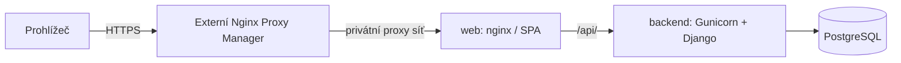

# Technická architektura

Architektura, aktualizace 2. 11. 2026. Ve fázi 1 vznikl základ frontend/backend/infra a Compose. Runtime Dockeru zůstává v tomto prostředí neověřený; aktuální výsledky jsou v PHASE_1.md. Vozidla, tankování a analytika nejsou implementované. Podle doplňujícího pokynu uživatele všechna trvalá aplikační data včetně budoucích příloh patří do PostgreSQL.

## 1. Modulární monolit

Jedno úložiště zdrojů, jedna Django aplikace rozdělená do domén, PostgreSQL a webová vstupní služba. React je SPA. Bez Redis, Celery, message brokeru, mikroservis nebo objektového úložiště, dokud nebude doložená potřeba. Nákupní i měřicí statistiky počítá backend, frontend pouze vykresluje a lokálně navrhuje částku formuláře.

Rozložení repozitáře (domény vehicles/refuelings/analytics vzniknou až v dalších etapách):

```text
frontend/                 React, komponenty, feature moduly a testy
backend/
  config/settings/        base.py, development.py, production.py, test.py
  apps/accounts/          vlastní User od první migrace, autentizace a správa
  apps/vehicles/          auta, granty a autorizační selektory
  apps/refuelings/        záznamy, validace, soukromé účtenky, XLSX
  apps/analytics/         čisté výpočty intervalů a dashboardové služby
  apps/audit/             audit významných změn
infra/                    Dockerfiles, nginx a později provozní postupy
docs/                     specifikace a rozhodnutí
compose.yaml              společné interní služby a svazky
compose.dev.yaml          hot reload a 127.0.0.1:8080
compose.prod.yaml         produkční build, Gunicorn, externí síť NPM
.env.example              názvy proměnných bez tajných hodnot, od fáze 1
.dockerignore             vyloučení tajných/provozních dat z buildu, od fáze 1
```

Django: views/serializers ověřují kontrakt, selektory omezují čtení podle práv, servisní funkce provádějí zápisy v transakcích a audit. `analytics` nepřistupuje k HTTP ani uživatelským sessions; dostává typované a seřazené vstupy. Statistické endpointy nejprve vyberou autorizovaná vozidla. Sdílené autorizační funkce používá i Django admin nebo je zápis mimo servisní vrstvu zakázaný.

React: feature moduly `auth`, `vehicles`, `refuelings`, `dashboard`, `administration`; společný API klient, komponenty, formátování a tokeny vzhledu. TanStack Query pro serverová data a invalidaci po změnách; React Hook Form + Zod pro formuláře. Žádný druhý globální store bez potřeby. Při odhlášení nebo ztrátě session vyčistit query cache a soukromé náhledy.

## 2. Technologie a ověřené řady

Ve fázi 1 jsou přesné závislosti zamknuté v `frontend/package-lock.json` a `backend/uv.lock`. Metadata verzí byla znovu ověřena přímo v registrech npm/PyPI a digesty image v oficiálním registry Dockeru. Konkrétní použité verze a testovací prostředí uvádí PHASE_1.md. Nové major verze se nepřebírají automaticky.

| Oblast | Návrh | Důvod a oficiální zdroj |
| --- | --- | --- |
| Python | 3.14, nejnovější patch | Podporovaná řada kompatibilní s Django 5.2; [stav Python verzí](https://devguide.python.org/versions/), [kompatibilita Django](https://docs.djangoproject.com/en/5.2/releases/5.2/) |
| Django | 5.2 LTS, nejnovější patch | Podpora do dubna 2028; novější 6.1 má kratší horizont podpory. [Oficiální přehled](https://www.djangoproject.com/download/) |
| DRF | 3.18, nejnovější patch | V době průzkumu release notes uvádějí 3.18.3; [požadavky](https://www.django-rest-framework.org/), [vydání](https://www.django-rest-framework.org/community/release-notes/) |
| PostgreSQL | 18, nejnovější minor | Podporovaná řada do listopadu 2030; [versioning policy](https://www.postgresql.org/support/versioning/) |
| Node.js | 26 LTS | Aktuální LTS k datu návrhu, jen build a vývoj; [release schedule](https://github.com/nodejs/Release) |
| React | 19.3 | Aktuální dokumentovaná řada; [React versions](https://react.dev/versions) |
| Vite | 8.3 | Aktuálně podporovaná řada pro pravidelné opravy; [Vite releases](https://vite.dev/releases) |
| Tailwind | 4.3 | Vite integrace v aktuální dokumentaci; [oficiální návod](https://tailwindcss.com/docs/installation/using-vite) |
| Další frontend | TypeScript, shadcn/ui, Lucide, Recharts, TanStack Query, RHF, Zod | Přesné stabilní kompatibilní verze prověřit při zavedení konkrétní funkce |
| Další backend | psycopg, Gunicorn, openpyxl, Pillow, django-axes | Přesné verze a podporu Python/Django uzamknout při zavedení |

Frontend používá npm a verzovaný `package-lock.json`, instalace přes `npm ci`. Backend `pyproject.toml` + `uv.lock`, synchronizace `uv sync --frozen` (v produkci bez vývojových závislostí). Verze uv i base images jsou připnuté; produkční obrazy na konkrétní tag a digest. Vygenerované shadcn komponenty se verzují a kontrolují jako vlastní zdrojový kód. Aktualizace locků jsou samostatná ověřená změna. Upgrade Django před koncem podpory je součást údržby.

## 3. Lokální Docker Compose

| Služba | Vývoj | Produkce |
| --- | --- | --- |
| `web` | nginx → Vite a Django | nginx se sestaveným SPA → Gunicorn |
| `frontend` | Vite, interní 5173, bind mount a HMR | Pouze build stage, žádný trvalý Node server |
| `backend` | Django runserver, interní 8000, bind mount | Gunicorn WSGI, interní 8000, immutable image |
| `db` | PostgreSQL, interní 5432 | PostgreSQL, interní 5432 |

Hostitel publikuje ve vývoji pouze `127.0.0.1:8080` na `web`. `/api/` jde na Django, ostatní cesty na Vite včetně websocketového upgradu pro HMR na stejném originu. Není potřeba CORS. Produkční nginx vrací SPA fallback jen pro frontendové cesty; `/api/` a privátní přílohy nikdy nesmějí skončit HTML fallbackem.

Základní Compose nemá host porty, vývojové mounty ani dev příkazy. Varianty se spouštějí vždy explicitně s base + jedním override; nikdy obě varianty najednou. Tím se zabrání zdědění vývojových portů a volumes při slučování. [Pravidla slučování Compose](https://docs.docker.com/compose/how-tos/multiple-compose-files/merge/) se ověří na výsledku `config`.

`db` má `pg_isready` healthcheck; backend kontrolu živosti a oddělenou připravenost s DB. Start pořadí není náhradou za retry databázového připojení. Migrace se provádí explicitním jednorázovým krokem před startem nové verze, nikoli současně v každém workeru. První správce se zakládá interaktivně přes management příkaz, bez výchozího hesla v `.env.example`. Syntetická demo data jen explicitním příkazem a pouze ve vývoji/testech.

Trvalá aplikační data jsou pouze ve svazku `postgres_data`; profil, motiv, oprávnění, sessions a v budoucnu originály/náhledy účtenek jsou v PostgreSQL. Vývoj navíc používá `frontend_modules` jako cache závislostí, nikoli uživatelská data. Vývoj má vlastní jméno projektu a svazky, produkce jiné. Svazek není záloha. Backend běží jako neprivilegovaný uživatel 10001. PostgreSQL 18 používá mount `/var/lib/postgresql` s verzovaným podadresářem; nejde o starší mount 17.x. Databázový svazek používá oprávnění vyžadovaná oficiálním image.

## 4. Produkční síť a jeden origin



Produkční web je připojen k externí Docker síti NPM a interní aplikační síti, bez veřejného host portu. Backend a DB nejsou připojeny k síti NPM; DB je dostupná pouze backendu v datové síti. Interní sítě nesmějí znemožnit budoucí řízené HTTPS volání RSV z backendu; do fáze 8 se externí integrace nepovoluje ani nespouští.

NPM nastaví důvěryhodné schéma a IP, web odstraní podvržené proxy hlavičky a předá jen hodnoty od důvěryhodné proxy. Backend důvěřuje `X-Forwarded-Proto` pouze přes tuto uzavřenou cestu, nikoli libovolnému klientovi. Nesmí se přepsat `https` na interní `$scheme=http`; to by rozbilo CSRF, secure cookies a mohlo způsobit smyčku redirectu. Přesnou konfiguraci a ochranu před podvržením ověřit v etapě nasazení. Změna domény/IP se řeší prostředím a proxy, bez přestavby API klienta používajícího relativní `/api/`.

## 5. Konfigurace prostředím

Plánované názvy do budoucího `.env.example`:

| Proměnné | Význam |
| --- | --- |
| `TANKLOG_ENV`, `DJANGO_SETTINGS_MODULE` | Explicitní prostředí a modul nastavení |
| `DJANGO_SECRET_KEY` | Povinná samostatná tajná hodnota, žádný produkční fallback |
| `DJANGO_ALLOWED_HOSTS` | Výčet hostů bez schématu; žádné `*` v produkci |
| `DJANGO_CSRF_TRUSTED_ORIGINS` | Úplné originy s HTTPS; ve vývoji konkrétní localhost origin |
| `DJANGO_DEBUG`, `DJANGO_SECURE_COOKIES` | Produkční konfigurace odmítne nebezpečné hodnoty |
| `POSTGRES_DB`, `POSTGRES_USER`, `POSTGRES_PASSWORD` | Připojení k interní `db`; heslo bez výchozí hodnoty |
| `TANKLOG_PUBLIC_ORIGIN` | Budoucí doména nebo http://localhost:8080 |
| Budoucí limit uploadu | Ve fázi 3 pevný horní limit 10 MiB; obsah přílohy v DB, žádná cesta k privátnímu svazku |
| `NPM_NETWORK_NAME` | Externí síť pro produkční `web` |
| `RSV_API_KEY` | Teprve fáze 8; nikdy prefix `VITE_` |

Jazyk cs, `TIME_ZONE=Europe/Prague`, `USE_TZ=True`. Technické timestampy jsou UTC, obchodní datum tankování je `DATE` a nepřevádí se přes UTC půlnoc. Žádné tajemství v build args, obrazu nebo klientském bundlu. Konkrétní timeouty, workery a limity paměti se nastaví podle ověřeného serveru, ne odhadem v dokumentaci.

## 6. Zápisy, přílohy a statistiky

Změna vozidla nebo jeho historie uzamkne řádek vozidla; zápis, revize a audit proběhnou v jedné DB transakci. Klient posílá očekávanou revizi proti ztraceným úpravám. Po mutaci se invalidují dotčené query; měřicí intervaly se pro MVP dopočítávají nad celou historií vozidla, až potom se filtrují podle koncového dne. Bez uložených duplicitních intervalů a bez cache, která by mohla přežít změnu oprávnění.

Budoucí upload se nejprve ověří v omezené pracovní paměti nebo dočasném privátním prostoru. Originál, očištěný náhled a metadata se pak uloží jako bytea v jedné DB transakci s auditem. Žádný trvalý soubor není mimo PostgreSQL. Požadavek uživatele tím nahrazuje původně navržený privátní filesystem; binární data a větší DB zálohy jsou vědomý kompromis pro tuto malou self-hosted aplikaci. Limity a ochranu popisuje [SECURITY.md](SECURITY.md).

Pro čtení příloh Django nejprve zkontroluje aktuální práva a vrátí omezený binární obsah z DB s bezpečnými hlavičkami. Žádný veřejný `/media/` alias ani X-Accel-Redirect na filesystem. Export openpyxl vytváří přímo backend; limity chrání paměť bez zavádění fronty. V prohlížeči je query cache jen v paměti; po odhlášení nebo zániku session se čistí. Uložené údaje a motiv se vždy znovu načtou z DB podle uživatele.
