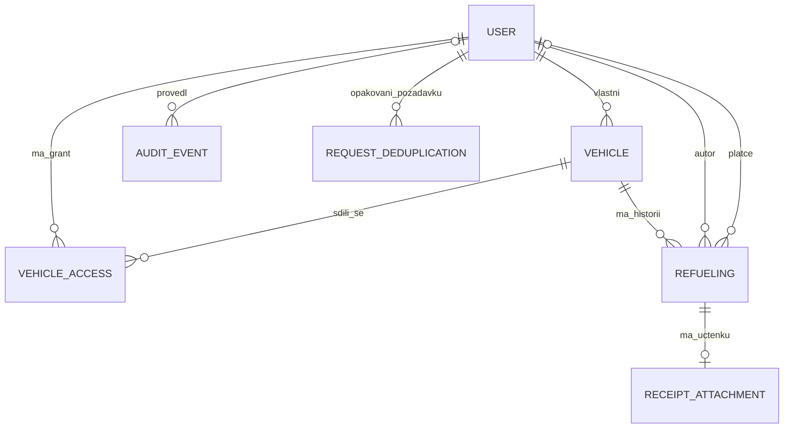

# Datový model

PostgreSQL/Django. Implementovány jsou User, DB sessions, audit, ochrana přihlášení a od fáze 2 také Vehicle/VehicleAccess; tankování zůstává návrhem. UUID jsou veřejné identifikátory, nikoli bezpečnostní mechanismus. Technické timestampy jsou timezone-aware UTC; obchodní datum je lokální `DATE`. Podle dodatku uživatele z fáze 1 se veškerá uložená aplikační data včetně budoucích příloh nacházejí v DB; prohlížeč není trvalým úložištěm.

## 1. Vztahy

`OWNER` se odvozuje z `Vehicle.owner_id`. `ADMIN` se odvozuje ze systémové role účtu. Ani jedno není řádek `VehicleAccess`. Díky tomu nevzniká konflikt mezi dvěma vlastníky či mezi grantem a FK. Přístupový selektor používá vlastnictví OR existenci grantu; nesmí násobit řádky tankování.

## 2. User (odvozený z Django AbstractUser)

| Pole | Typ / pravidlo |
| --- | --- |
| `id` | UUID PK |
| `username` | max. 150, case-insensitive unikátní index přes normalizovanou hodnotu; po vytvoření neměnné |
| `email`, `display_name` | nepovinný validovaný kontakt; zobrazované jméno max. 150 |
| `password` | standardní Django hash, žádné vlastní kryptografické schéma |
| `system_role` | `ADMIN` / `USER`, výchozí USER; klient profilu nesmí zapisovat |
| `is_active` | deaktivace bez odstranění historie |
| `must_change_password` | povinná změna po založení/resetu |
| `temporary_password_expires_at`, `temporary_password_consumed_at` | nullable UTC timestampy pro jednorázový proces |
| `auth_epoch` | nezáporné číslo, zvýšit při resetu, změně hesla a deaktivaci; session nese odpovídající verzi |
| `theme` | `SYSTEM` / `LIGHT` / `DARK`, výchozí SYSTEM |
| `version`, `created_at`, `updated_at`, `last_login` | optimistické řízení souběhu a historie |

Django technické `is_staff`/`is_superuser` nejsou další uživatelské role. Spravují se pouze řízenou službou/management příkazem a nesmějí umožnit eskalaci přes profil. Nouzový superuser je systémový ADMIN. Posledního aktivního ADMIN nelze deaktivovat nebo degradovat; kontrola pod databázovým zámkem zabrání souběžnému odebrání obou správců.

Session data používají standardní tabulku Django sessions. Omezená session po spotřebování dočasného hesla obsahuje pouze režim změny hesla a platí 15 minut. Pravidla autentizace nejsou samotným booleanem vyřešena; musí je vynucovat backend na každém požadavku.

## 3. Vehicle

| Pole | Typ / pravidlo |
| --- | --- |
| `id`, `owner_id` | UUID PK; FK User s `PROTECT`, právě jeden vlastník |
| `name`, `make`, `model` | povinné řetězce, max. 100 každý |
| `manufacture_year` | nullable smallint; rozumný rozsah 1886 až aktuální rok + 1 |
| `registration_plate` | prázdný řetězec nebo max. 20; normalizace mezer/písmen, bez globální UNIQUE |
| `vin` | nullable max. 17; normalizované, neprázdné hodnoty UNIQUE; běžný VIN formát |
| `fuel_type` | PETROL / DIESEL / LPG / ETHANOL / OTHER_LIQUID |
| `consumption_mode` | SINGLE_TANK / UNSUPPORTED_MULTI_TANK; druhý režim blokuje měření, zachová výdaje |
| `engine_displacement_cc` | nullable kladné celé číslo |
| `power_kw` | nullable Decimal(8,2), kladné |
| `tank_capacity_l` | nullable Decimal(8,3), kladné |
| `standard_consumption_l_100km` | nullable Decimal(7,3), kladné |
| `standard_methodology` | WLTP / NEDC / MANUFACTURER / USER_ESTIMATE / UNKNOWN |
| `standard_source`, `standard_source_note` | nepovinný název/URL zdroje a vysvětlení; žádné automatické serverové načítání libovolné URL |
| `initial_odometer_km` | bigint, 0 až 99 999 999; není referenční plnou nádrží |
| `status` | ACTIVE / ARCHIVED |
| `version`, `history_revision` | verze metadat a verze celé tankovací historie; nezáporná rostoucí čísla |
| `created_at`, `updated_at`, `archived_at` | timestampy; `archived_at` jen pro archivované auto |

`owner_id` nepřijímá běžný serializer vozidla. Převod vlastníka má samostatnou administrační operaci. Při převodu se odstraní případný grant nového vlastníka; starému se nic nepřiděluje automaticky. Změna počátečního tachometru nebo paliva přepočítá kvalitu celé historie. Mazání auta s navázanými záznamy je zablokované (`PROTECT`).

## 4. VehicleAccess

| Pole | Typ / pravidlo |
| --- | --- |
| `id` | UUID PK |
| `vehicle_id`, `user_id` | FK; UNIQUE dvojice vozidlo–uživatel |
| `role` | pouze VIEWER / CONTRIBUTOR |
| `granted_by_id` | FK User PROTECT, nastavuje server |
| `version`, `created_at`, `updated_at` | řízení souběhu a auditovatelnost |

Grant vlastníkovi odmítnout v servisní vrstvě pod zámkem vozidla; cross-table kontrolu nelze vyjádřit prostým CHECK. Přímé zápisy mimo tuto vrstvu nejsou povoleny. Grant deaktivovanému účtu nezakládá aktivní přístup; nové sdílení je možné jen aktivnímu účtu. Odebrání grantu odstraní řádek, audit zůstává.

## 5. Refueling

| Pole | Typ / pravidlo |
| --- | --- |
| `id`, `vehicle_id` | UUID PK a FK Vehicle PROTECT; auto záznamu je po vytvoření neměnné |
| `date`, `day_sequence` | DATE a kladné celé pořadí v daném autě/dni |
| `liters` | Decimal(10,3), > 0 |
| `unit_price_entered` | nullable Decimal(10,4), >= 0; pouze skutečně zadaná cena |
| `total_amount` | Decimal(14,2), >= 0; autoritativní zaplacená částka |
| `amount_source` | ENTERED / CALCULATED; zda částku zadal uživatel nebo vznikla ze součinu |
| `odometer_km` | nullable bigint 0 až 99 999 999 |
| `is_full_tank` | boolean, výchozí false; žádný odhad podle množství |
| `break_before` | boolean; od předchozího záznamu je známá mezera v evidenci |
| `fuel_type` | skutečné palivo, při vytvoření předvyplněno z vozidla |
| `station_code` | nullable ORLEN / SHELL / MOL / OMV / EUROOIL / TANK_ONO / OTHER |
| `station_custom_name` | max. 120; vyplněné jen při OTHER |
| `note` | nepovinné, max. 2 000 znaků |
| `created_by_id`, `updated_by_id` | FK User PROTECT, nastavuje server; původní autor se nemění |
| `paid_by_user_id`, `paid_by_label` | nullable FK User PROTECT / max. 150 znaků; právě nejvýše jedno vyplněné |
| `version`, `created_at`, `updated_at` | ochrana proti ztracené editaci a audit |

Povinný DB CHECK pro kladné litry, nezápornou částku/cenu/tachometr, kladné pořadí a vzájemně výlučného plátce. `UNIQUE(vehicle_id, date, day_sequence)` je odložitelný constraint (`DEFERRABLE DEFERRED`) pro bezpečné přečíslování v transakci. Timestamps ani náhodné UUID neurčují pořadí měření. Změna data přesune záznam do zvolené pozice cílového dne; obě pořadí se upraví atomicky.

Efektivní jednotková cena `total_amount / liters`, varování a kvalita měření jsou odvozené hodnoty, ne druhá autoritativní pole. V databázi se neukládá jedna „spotřeba tankování“, protože interval může obsahovat několik nákupů a mění se po zpětné editaci.

Odstranění záznamu provádí OWNER/ADMIN s potvrzením, auditem a přepočtem. Audit uchová povolená účetní pole pro dohledání, ale ne obsah obrázku. Nejde o uživatelskou funkci obnovení smazaného záznamu. K vymazání dat ze záloh platí retenční postup, nikoli přepis starých záloh při každém DELETE.

## 6. ReceiptAttachment

| Pole | Typ / pravidlo |
| --- | --- |
| `id`, `refueling_id` | UUID PK a unikátní FK (nejvýše jedna účtenka) |
| `original_bytes`, `preview_bytes` | BinaryField / PostgreSQL bytea; originál do 10 MiB, očištěný náhled do 2 MiB, neveřejné |
| `content_type`, `size_bytes`, `width`, `height` | ověřené údaje po skutečném dekódování |
| `sha256` | integrita a detekce identických souborů; bez globálního sdílení souborů mezi auty |
| `original_filename` | očištěný název pro stažení, nezveřejňovat cestu klientského zařízení |
| `uploaded_by_id`, `created_at`, `version` | původ a souběh |

Příloha dědí čtecí práva výhradně z tankování a auta. Její změna vyžaduje právo upravit tankování, její smazání stejné právo (nejde o smazání celého tankování). Validovaný originál a náhled se mění atomicky v DB transakci spolu s metadaty/auditem; rollback zachová původní obsah. Velikosti validovat v aplikaci a při implementaci přidat DB kontroly octet_length. Neexistují trvalé souborové cesty ani storage key; ID přílohy slouží autorizovanému stažení z backendu. Budoucí OCR model bude samostatný a nebude do tohoto modelu předem přidávat neexistující job infrastrukturu.

## 7. AuditEvent a RequestDeduplication

`AuditEvent`: UUID, `occurred_at`, nullable `actor_id` (systémová operace nemá uživatele), `action`, `entity_type`, `entity_id`, `vehicle_id` jako nullable UUID (implementováno ve fázi 2) pokud existuje, `request_id`, povolený JSON diff a případný důvod. Objekty se odkazují také identifikátorem, aby audit přežil jejich smazání. Žádná hesla, resetovací tokeny, cookie, API klíč, obrázky, úplné request body ani celé prostředí. Auditovat správu účtů/rolí/sdílení, převody, archivaci, změny a mazání tankování a příloh, změny pořadí a bezpečnostní události. API umožní pouze čtení auditu ADMIN. DB role provozní aplikace nesmí běžným rozhraním audit měnit; to není kryptografická ochrana před správcem DB.

`RequestDeduplication` od fáze 3: uživatel, klientské UUID klíče, hash normalizovaného payloadu, výsledné ID objektu/stav a čas expirace. UNIQUE `(user_id, key)`, platnost minimálně 24 h. Záznam i vytvoření tankování se potvrzují společně. Opakování stejného těla vrátí již vytvořený objekt po nové kontrole práv; jiné tělo pod stejným klíčem vrátí 409. Pokud objekt mezitím zmizel nebo byl odebrán přístup, nesmí se znovu vytvořit ani prozradit jeho obsah. Po expiraci klient při nejasném výsledku nejprve ověří historii, místo slepého opakování. Neúspěšná validace klíč nespotřebuje.

## 8. Indexy a konzistence

- Vehicle: `(owner_id, status)`, unikátní vyplněný VIN.
- VehicleAccess: unikátní `(vehicle_id, user_id)`, další `(user_id, vehicle_id)` pro autorizovaný seznam.
- Refueling: unikátní pořadí; `(vehicle_id, date, day_sequence)`, `date`, případně `(fuel_type, date)` a `(station_code, date)` podle skutečného EXPLAIN. Nepřidávat slepě všechny kombinace.
- AuditEvent: `(entity_type, entity_id, occurred_at)` a `occurred_at`; RequestDeduplication: klíč a expirace.
- Hledání malé historie nejprve jednoduchým omezeným dotazem; trigram/fulltext až při doložené potřebě.

Každá změna historie, vlastnictví, archivace a grantu používá společný zámek řádku vozidla, znovu ověří práva, provede změnu a audit v transakci. Zvýšení `history_revision` při tankování, pořadí a relevantní příloze umožní invalidovat klientská data. Metadatové `version` se zvyšuje při změně vlastního objektu. Převody/zámky více uživatelů mají stabilní pořadí ID, aby se omezily deadlocky.

Statistiky čtou jednu konzistentní DB snapshot transakci, aby nákupní součty a intervaly ve stejné odpovědi pocházely ze shodné historie. Uložení binárních příloh do PostgreSQL odstraňuje potřebu koordinovat jejich trvalý filesystem s transakcí. Konzistentní záloha DB obsahuje i originály/náhledy; prostorové nároky a obnova se ověří podle [SECURITY.md](SECURITY.md).

## 9. Implementační pravidla fáze 2

Vehicle/VehicleAccess a UUID vehicle_id v auditu mají verzované migrace. Nevyplněný VIN se normalizuje na NULL, registrační značka na velká písmena a jednotlivé mezery; nepovinné zdroje/poznámky jsou prázdné řetězce. Číselné technické údaje zůstávají Decimal a API vrací desetinné řetězce. Rok má při zápisu dynamickou horní mez aktuální rok v Praze + 1, DB hlídá dolní mez 1886. DB kontroluje také rozsah tachometru, kladné technické hodnoty, konzistenci archivace, role grantů a unikátní VIN/dvojici grantů.

Version vozidla začíná 1, history_revision 0 (historie se implementuje až ve fázi 3). Verze vozidla roste i při změně grantů; verze existujícího grantu při změně jeho role. Veřejný DELETE vozidla není dostupný ani pro auto bez historie; uživatelský postup je archivace. Všechny podporované zápisy jdou přes služby, přímé zápisy modelů jsou vyhrazené migracím a testům. Testy fáze 2 prokazují konzistenci současných entit; ochrana budoucích tankování se doplní s jejich modelem.
